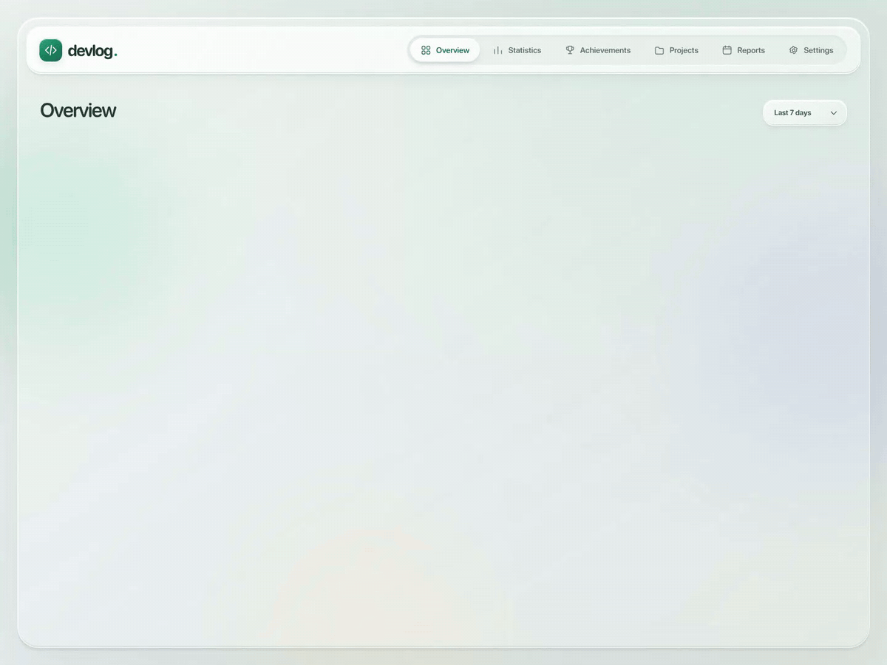
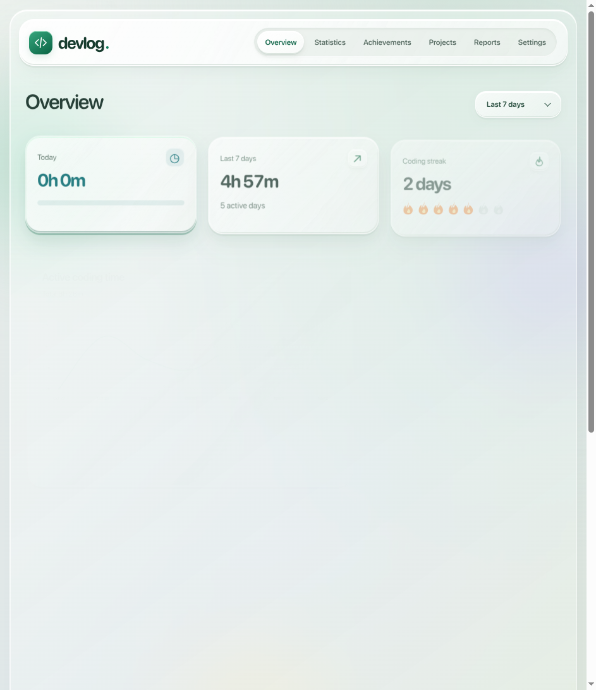
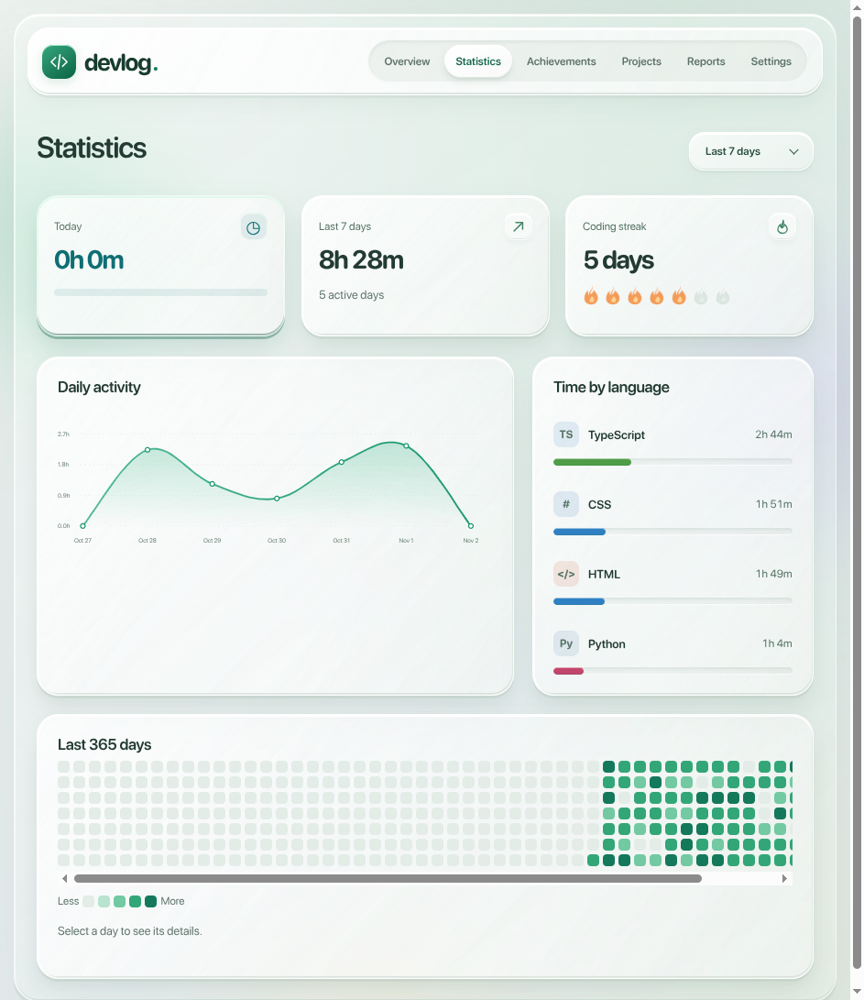
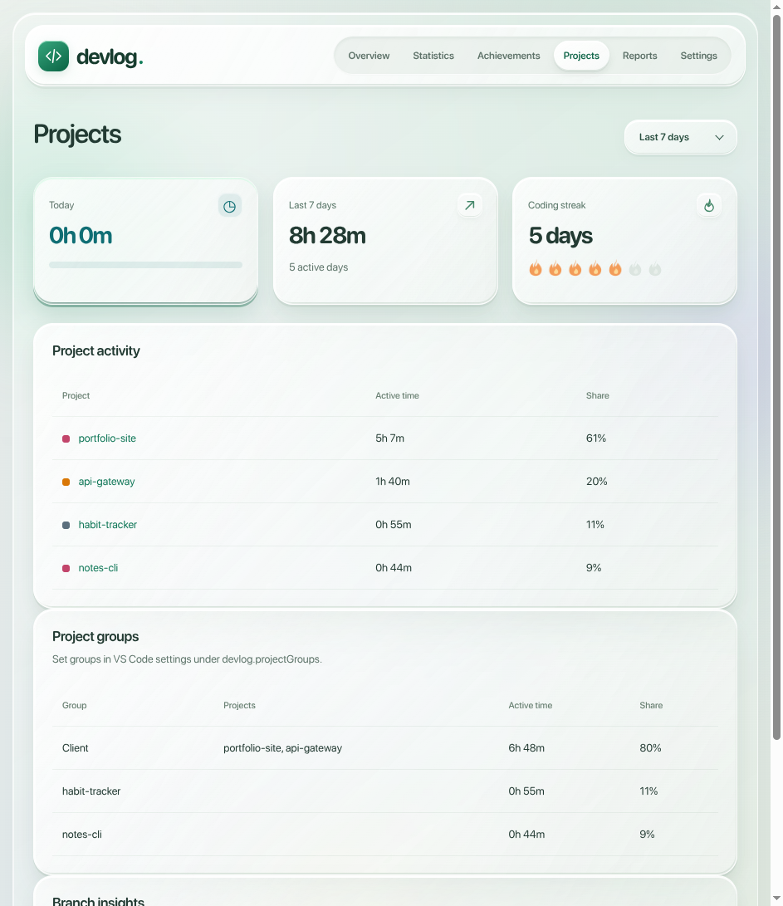
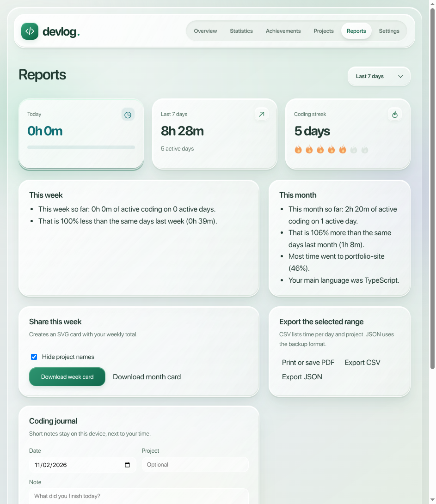
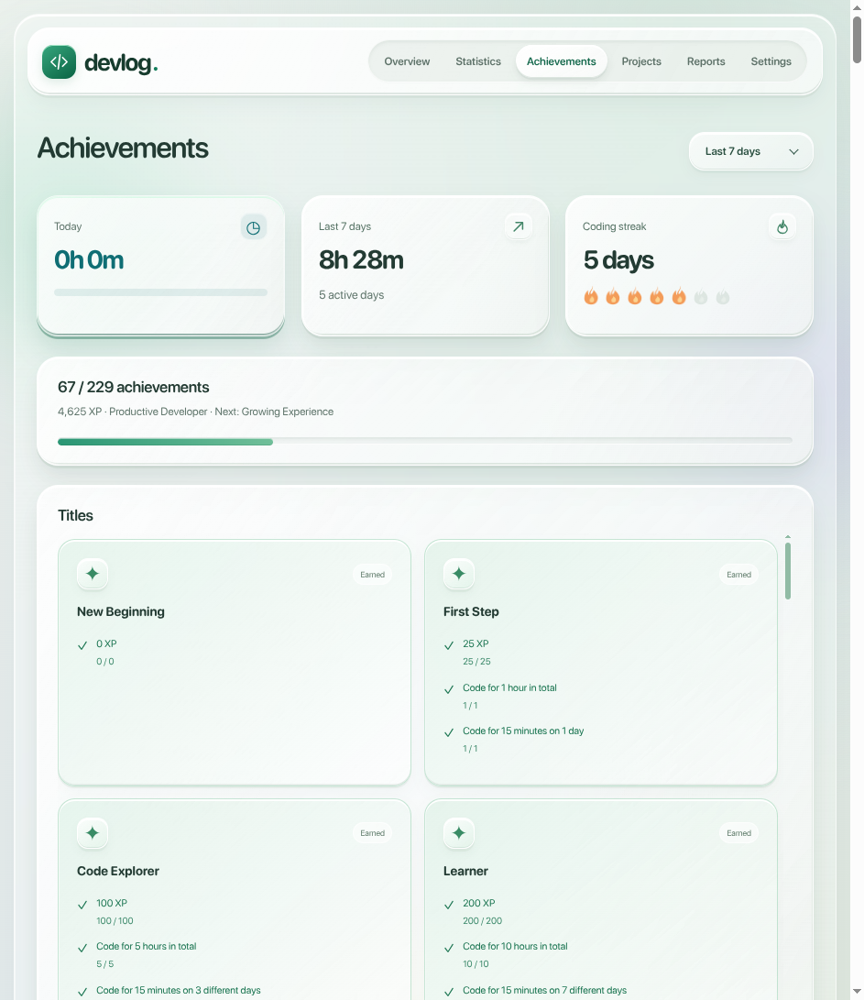
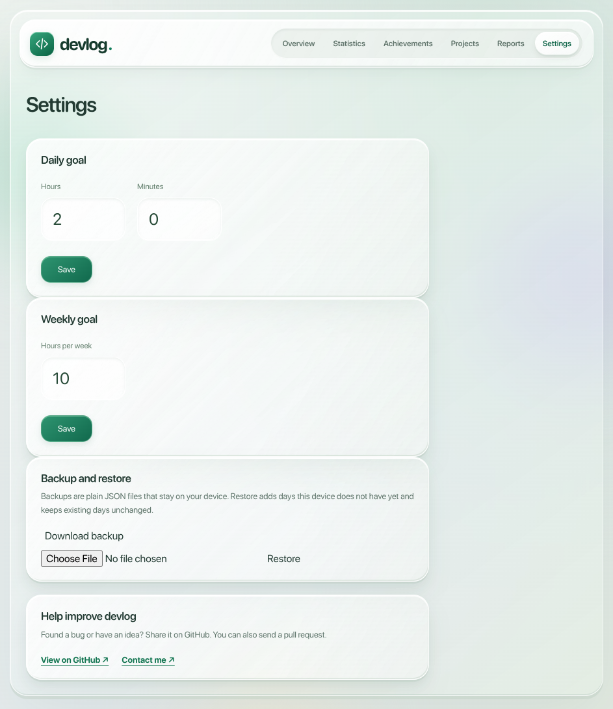
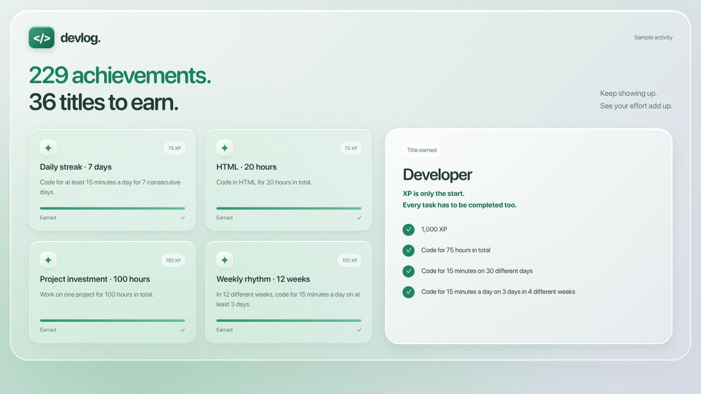

# devlog

**Track your coding time and see your progress.**

devlog runs in VS Code and opens your stats in your browser. See how much time you spend coding, what you work on, and how your habits change.

[Install from the VS Code Marketplace](https://marketplace.visualstudio.com/items?itemName=ardazeybek.devlog-coding-activity) · [Report a bug](https://github.com/ardazeybek/devlog/issues) · [Get in touch](mailto:quantastudio.dev@gmail.com)

_The screenshots and the overview GIF move through Overview, Achievements, Projects, and Reports. They use sample activity, not someone's personal coding history._

## Screens

| Overview                                                                                                                                                             | Statistics                                                                                                                                                        |
| -------------------------------------------------------------------------------------------------------------------------------------------------------------------- | ----------------------------------------------------------------------------------------------------------------------------------------------------------------- |
|  |  |

| Projects                                                                                                                                          | Reports                                                                                                                                                        |
| ------------------------------------------------------------------------------------------------------------------------------------------------- | -------------------------------------------------------------------------------------------------------------------------------------------------------------- |
|  |  |

| Achievements                                                                                                                                   | Settings                                                                                                                                                  |
| ---------------------------------------------------------------------------------------------------------------------------------------------- | --------------------------------------------------------------------------------------------------------------------------------------------------------- |
|  |  |

## A little motivation to keep going

Set a daily goal, build a streak, and earn achievements as you code. There are **229 achievements and 36 titles** to work toward. Titles need both XP and completed tasks, so collecting easy achievements alone won't unlock the higher ones.

## Reports, notes, and projects

The **Reports** page compares your week and month with the same days before, and points out your main project and language. Share a card with your weekly total (project names can stay hidden), or export CSV or a backup JSON file. Print or save a PDF from the same page.

Add a short journal note to remember what you worked on. In **Projects**, group related projects together and see how each one is split across branches.

## Get started

1. Install devlog from the link above.
2. Write some code in a saved or unsaved file.
3. Click devlog in the VS Code sidebar, then **Open Dashboard**. You can also click devlog in the bottom status bar.
4. Choose your daily goal in **Settings**.

devlog works on desktop VS Code for Windows, macOS, and Linux. Your activity stays on your computer. No account or subscription is needed.

New achievements and titles come with a silent notification. The dashboard celebrates with a small confetti burst; when it is closed, VS Code lets you know instead. Existing achievements are not replayed when you open the app.

## How time is counted

devlog counts time while VS Code is focused and you're making small edits in the active file. It stops after a minute without an edit. Reading, terminal work, and time in other apps are not counted. Pasting a large block or using undo does not start the timer.

Unsaved files work too. Pick the right language in VS Code for accurate stats. Plain Text counts toward your time but does not appear as a programming language.

Use **Pause / Resume Tracking** in the sidebar to take a break. If the dashboard loses its connection, open it again from VS Code.

## How this project was made

**devlog started as an AI-built project.** I came up with the idea, chose the features and design, and tried the app as it was built. AI wrote the initial code. I don't yet understand every part of it, and I don't present it as code I wrote entirely by hand.

I'm currently learning HTML. As I learn, I plan to take on the HTML changes and fixes myself, then gradually work through the rest of the project. My goal is to understand the whole app and be able to maintain and develop it on my own.

I keep [the projects I code myself and my AI-built projects separate on my profile](https://github.com/ardazeybek#readme), so it's clear how each one was made.

## Want to help?

Bug reports, ideas, documentation fixes, and code contributions are welcome. Open an issue or send a pull request. I'll review proposed changes before merging them. See [Contributing](CONTRIBUTING.md) for the steps.

You can also reach me at **quantastudio.dev@gmail.com**. If devlog is useful to you, a GitHub star is a nice way to support it.

## Working on the code

devlog uses JavaScript, HTML, and CSS. There are no runtime dependencies.

- Use Node.js 20 or newer and run `npm test`.
- Open the folder in VS Code and press **F5** to try the extension in a separate window.
- Start with [Development](DEVELOPMENT.md), the [project map](docs/architecture/project-map.md), and the [data flow](docs/architecture/data-flow.md).

All rights reserved. The source is published for viewing only; see the [license](LICENSE). Read the [privacy note](PRIVACY.md) for details about saved data.
