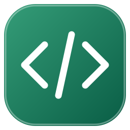

<div align="center">
  
  <h1>devlog</h1>
  <p><strong>See where your coding time goes, right from VS Code.</strong></p>
  <p>A local activity tracker with a browser dashboard for your time, projects, languages, and goals.</p>
  <p><a href="#get-started">Get started</a> · <a href="#run-from-source">Setup</a> · <a href="https://github.com/ardazeybek/devlog/blob/main/CONTRIBUTING.md">Contribute</a> · <a href="mailto:quantastudio.dev@gmail.com">Contact</a></p>
</div>


_The real dashboard opening with synthetic activity. The cards and charts animate into view; no personal coding history is shown._

## What is devlog?

Devlog helps developers understand how much time they spend actively editing code and which projects and languages they work on. It runs as a desktop VS Code extension and opens its dashboard in your browser.

Activity stays on your computer. There is no account, subscription, or external service to configure. Desktop VS Code on Windows, macOS, and Linux is supported.

## Features

- **Time and habits** — See daily totals, recent activity, streaks, and a yearly heatmap.
- **Projects and languages** — Find where your time goes, inspect branches, and group related projects.
- **Goals and achievements** — Set daily and weekly targets and follow your progress through achievements and titles.
- **Reports and exports** — Compare weeks and months, export CSV or JSON backups, and print reports to PDF.
- **Notes and sharing** — Add a short journal note and create a weekly summary card with optional project names.
- **Local controls** — Pause tracking, exclude projects or folders, and back up or restore activity.

## Get started

Devlog is free and open source under the [MIT license](LICENSE). You can install, use, modify, and share it without asking for permission.

The extension is available on the [Visual Studio Marketplace](https://marketplace.visualstudio.com/items?itemName=ardazeybek.devlog-coding-activity). You can also [run from source](#run-from-source).

1. Install **devlog — Coding Activity** from the Marketplace in desktop VS Code.
2. Edit a saved or unsaved file.
3. Run **devlog: Open Dashboard** from the Command Palette, or use the devlog sidebar or status bar.
4. Open **Settings** in the dashboard to choose daily and weekly goals.

Keep VS Code open while using the dashboard. If it disconnects, run **devlog: Open Dashboard** again.

### How time is counted

Devlog counts active editing while VS Code is focused. By default, counting stops after 60 seconds without an edit. Reading, terminal work, and time in other apps are not counted. Large pastes and undo operations do not start the timer.

Unsaved files are supported; select their language in VS Code for accurate language statistics. Plain Text contributes to time totals but is not listed as a programming language. Use **devlog: Pause / Resume Tracking** to take a break.

### A closer look


_Overview brings your recent activity and goals together._

<details>
<summary>Explore projects, reports, and other screens</summary>


_Projects helps you compare work and organize related projects._


_Reports compares your activity and provides sharing and export tools._

[Statistics](https://raw.githubusercontent.com/ardazeybek/devlog/main/media/screenshots/statistics.png) · [Achievements](https://raw.githubusercontent.com/ardazeybek/devlog/main/media/screenshots/achievements.png) · [Settings](https://raw.githubusercontent.com/ardazeybek/devlog/main/media/screenshots/settings.png)

</details>

## Run from source

You need **Node.js 20 or newer**, **Git**, and **desktop VS Code 1.90 or newer**.

```sh
git clone https://github.com/ardazeybek/devlog.git
cd devlog
code .
```

1. Press **F5** in VS Code and select **Run Devlog** if prompted. This opens an Extension Development Host window.
2. Open a sample project in that window and edit a file.
3. Run **devlog: Open Dashboard** there. Your browser opens a local address selected by the extension.

There is no build step, runtime dependency installation, API key, environment file, or database setup. Use a separate VS Code development profile to keep test activity apart from your own history.

## Development

The extension uses JavaScript with CommonJS; the dashboard uses HTML, CSS, and native JavaScript modules. No runtime dependencies are required.

```sh
# Run the existing checks without installing dependencies
npm test

# Install the development formatter and check formatting
npm ci
npm run format:check
```

Start with [Development](DEVELOPMENT.md), the [project map](docs/architecture/project-map.md), and the [data flow](docs/architecture/data-flow.md). Packaging instructions are in the development guide.

### How this project was made

Devlog started as an AI-built project. I came up with the idea, chose the features and design, and tested the app as it was built. AI wrote the initial code; I do not present it as code I wrote entirely by hand.

I am learning HTML and plan to take on changes gradually so I can understand and maintain the app myself. My [profile](https://github.com/ardazeybek#readme) distinguishes projects I code myself from AI-built projects.

## Contributing

Bug reports, feature ideas, documentation, translations, testing, design, and accessibility feedback are welcome through [Issues](https://github.com/ardazeybek/devlog/issues).

For code changes, fork the repository, create a branch, make a focused change, run the relevant checks, and open a pull request. Discuss larger changes in an issue first. See [CONTRIBUTING.md](CONTRIBUTING.md) for setup, review expectations, and contribution terms.

## Support and contact

- **Bugs and feature requests:** [GitHub Issues](https://github.com/ardazeybek/devlog/issues).
- **Questions and collaboration:** [quantastudio.dev@gmail.com](mailto:quantastudio.dev@gmail.com).
- **Help with tracking or connecting:** [Support guide](SUPPORT.md).
- **What is saved locally:** [Privacy note](PRIVACY.md).

## License

Devlog is open source under the [MIT license](LICENSE). You may use it for personal or commercial purposes, modify it, distribute it, and include it in your own projects. Keep the copyright and license notice with copies or substantial portions of the software.

Copyright © 2026 Arda Zeybek. Third-party components retain their own licenses.
