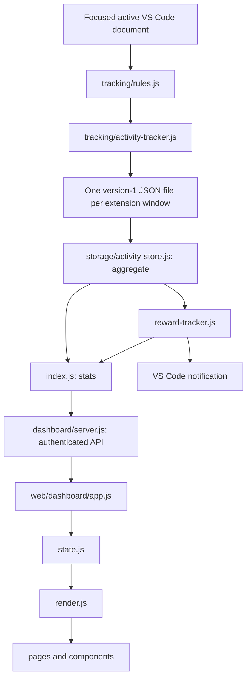

# Data flow and contracts

## From edit to dashboard



## Tracking decisions

`classify()` ignores undo/redo for credit. Changes longer than 32 characters or more than two text lines count as bulk characters and do not start active time. Smaller edits count typed characters, added and removed lines, and edit events. A deletion is still an edit.

Only the focused window's active document is eligible. Local files must pass folder and extension exclusions; untitled files are supported. The selected VS Code language is authoritative unless it is Plain Text, in which case a short in-memory sample may recognize HTML. Document contents and full paths are not persisted.

The five-second timer credits elapsed time only while the same document remains active, tracking is not paused, the window has focus, the last eligible edit is at most 60 seconds old, and the tick interval is greater than zero and at most ten seconds. Window/editor changes and pause changes reset the active session. These bounds prevent idle or suspended time from being credited.

Day buckets use the local calendar. Shared reward calendar calculations use UTC noon to compare recorded date keys consistently. These are existing behaviors; do not change their timezone semantics during a file move.

## Persisted activity

VS Code supplies `context.globalStorageUri.fsPath`. Each activated extension window writes a random UUID JSON file:

```json
{
  "version": 1,
  "days": {
    "2026-01-01": {
      "seconds": 60,
      "typed": 10,
      "added": 1,
      "removed": 0,
      "bulk": 0,
      "edits": 10,
      "manualSeconds": 0,
      "projects": { "Example": 60 },
      "languages": { "html": 60 }
    }
  }
}
```

`manualSeconds` is a retained schema field; current tracking does not add manual time. `atomicWrite()` writes a temporary file with owner-only permissions and renames it into place. `aggregate()` reads sorted `.json` files, merges valid version-1 days, ignores invalid/negative/non-finite counter values, and reports unreadable files. Dictionary fields use null-prototype objects so user-controlled project and language names are ordinary keys.

The refactor changes source locations, not this schema, the storage directory, UUID filenames, command IDs, configuration keys, extension identity or reward IDs. No migration is required.

## Reward claims

`src/shared/achievements.js` derives metrics, 229 achievements and 36 titles from recorded days. Titles require every listed XP and activity condition. `reward-tracker.js` stores already-seen IDs and up to 64 recent events in `.reward-notifications`. An exclusive lock coordinates extension windows; a stale lock can be reclaimed after 30 seconds. Existing rewards form a quiet baseline on initialization.

On a credited tick, the extension saves first and then checks rewards. A recent visible-dashboard heartbeat suppresses native notifications for 20 seconds. The browser receives recent events in stats, ignores its initial baseline, and queues new celebrations while hidden. Reward failures must not prevent time tracking.

## HTTP boundary

The server starts on demand, binds `127.0.0.1` on a dynamic port, and is closed during extension disposal. A random 32-byte session token reaches the browser through the URL fragment and is then retained in session storage. The browser removes the fragment from its address bar. API calls send `Authorization: Bearer <token>`.

| Route                 | Method     | Contract                                                                                                                           |
| --------------------- | ---------- | ---------------------------------------------------------------------------------------------------------------------------------- |
| `/api/stats`          | GET        | `{ days, goal, weeklyGoal, paused, trackingStatus, projectAliases, projectGroups, journal, live, languages, rewardEvents, issue }` |
| `/api/journal`        | GET / POST | GET returns `{ notes }`; POST `{ date, project, text }` returns `{ note }` (201)                                                   |
| `/api/journal/remove` | POST       | `{ id }` returns `{ removed }`                                                                                                     |
| `/api/days/delete`    | POST       | `{ date }` for a past day; returns `{ deleted }`                                                                                   |
| `/api/settings`       | POST       | JSON with exactly one of `{ dailyGoalMinutes }` or `{ weeklyGoalMinutes }`; returns `{ goal, weeklyGoal }`                         |
| `/api/restore`        | POST       | Version-1 backup JSON up to 10 MB; returns `{ restored, skipped }`                                                                 |
| URLs in `assets.js`   | GET / HEAD | Explicitly approved HTML, JS and CSS only                                                                                          |

The daily goal must be an integer from 15 to 720 minutes; the weekly goal from 60 to 10080 minutes. The request body is limited to 1,024 bytes and requires JSON content type. API requests check token, Host and any supplied Origin. Static files use the explicit allowlist; no filesystem directory or extension-private module is served. Headers disable caching and sniffing and set the existing content-security and referrer policies.

`issue` is `STORAGE_WRITE_FAILED`, `PARTIAL_DATA` or `null`. A stats storage exception returns HTTP 500; the browser distinguishes expired sessions, storage errors and disconnections.

## Sessions, branches and journal

Each day record may carry optional `sessions` (`{ start, end, project, language }` in minutes since local midnight, merged when activity continues within two minutes) and `branches` (keys of `project` + U+001F + branch name, read from `.git/HEAD` of the workspace folder). Both are optional, so version-1 files without them stay valid. Journal notes live in `journal.json` with `version: 2`, which activity aggregation skips.

`trackingStatus` is one of `counting`, `paused`, `unfocused`, `idle`, `excluded` or `waiting`. The settings `devlog.idleTimeoutSeconds` (15-600) and `devlog.excludedProjects` change tracking. `projectAliases` renames projects in the browser before any view is built.

## Deleting a day

`POST /api/days/delete` accepts only past days. `deleteDay()` writes the date to `deleted-days.json` (version 2) and removes it from every version-1 file. Aggregation hides listed days in all windows. A backup restore that contains a deleted day removes it from the list and writes the backup values.

## Backup and restore

Backups are version-1 documents of day records. `restoreDays()` in `storage/activity-store.js` skips every day the device already has, drops invalid counters and writes the remaining days to `restore-<hash>.json`. The content hash makes a repeated restore of the same file a no-op. Exports and backups are produced in the browser from the same API snapshot.

## Render lifecycle

The selected range (7, 30, 90 days, this year, all time or custom dates) is resolved in `analytics.js`; the Reports page and the heatmap use the same day records. The app polls every ten seconds and when the document becomes visible. Unchanged snapshots do not rebuild the DOM. Refresh avoids rebuilding Settings and active achievement filters so typing is not interrupted. On the same tab, `render()` captures page position and the title catalog's independent scroll position, replaces content, rebinds handlers, restores both positions, enhances selects and starts appropriate visual effects. Celebration cards live outside the replaced content container.
